**Also built:** [Subscription Tracker](https://github.com/ranjanvrma/subscription-tracker), a Python and MySQL app for tracking recurring subscriptions.

**Outside coursework:** I head the media team (photography, video and social media) for Ganesh Chaturthi 2026 at SIT. I was co-head in 2025.
